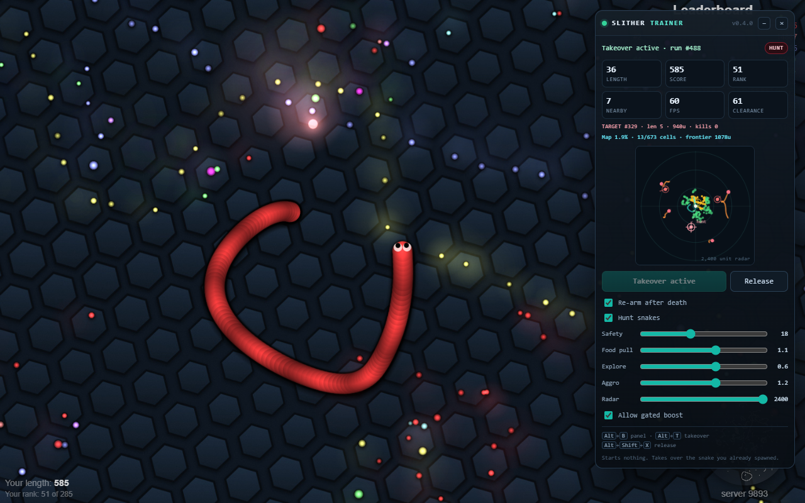

# Slither.io Trainer Panel

A browser-injectable trainer for [slither.io](https://slither.io). You start the
game normally, inject `panel/trainer/trainer.js`, and the panel can take over the
snake you already spawned. It reads the client's own live state and writes only
the game's normal local steering and boost fields.

The production trainer is **takeover-only**. It never launches a browser,
navigates, clicks **Play**, reconnects, or creates a run. The Playwright harness
in `panel/trainer/tests/` is test-only.



> **Project status: experimental.** v0.4.0 has a radar, threat-aware steering,
> food-density farming, corpse feasts, peer hunting, tail bait and a map
> frontier. The current best headed live result is a **180 s** run that was
> released while alive at trainer length `36`, displayed length/score `585`,
> rank `51`, with `0` confirmed kills. Rank `1` and reliable live kills remain
> open problems; see [Results](#results) and
> [docs/PERFORMANCE.md](docs/PERFORMANCE.md).

> **Responsible use:** this is a research project about planning and collision
> avoidance. It is not affiliated with Slither.io or Lowtech Studios. Using bots
> may break the game's terms of service. Run it sparingly, one instance at a
> time, and do not use it to disrupt other players or hammer the game's servers.
> Use it at your own risk.

---

## Features

- **Live-state planner:** 24 coarse, 14 fine and 8 ultra-fine headings scored by a
  short rollout with turn-rate limits and a control-lag model.
- **Threat radar:** heads, predicted head motion, enemy body points and walls
  inside `2,400` units. Time-to-collision, closest approach, crowd pressure and
  faster-chaser checks decide whether a head is actually dangerous.
- **Body-aware safety:** enemy bodies are collected even when their heads are
  outside the threat radius. The locked target's body gets priority in the body
  budget.
- **Hunting and peer traps:** chase, cut, coil, tail bait and gated boost bursts.
  Prey up to the trainer's own length is eligible when it is slower or crossing.
  A fast peer that closes head-on is dropped early instead of traded.
- **Feeding and feasts:** food lanes, local pellet-density weighting, large
  pellets and timed corpse sites. Food pull is cut to `8%` while a hunt is live.
- **Map exploration:** a coarse visited grid, coverage percentage and nearest
  unvisited frontier. The **Explore** slider controls the vote; safety always has
  the final say.
- **Takeover boundary:** input shielding while active, instant **Release**,
  hotkeys, and a death that stops control without clicking **Play Again**.

---

## Quick start

### DevTools (no install)

1. Open <https://slither.io> and start a run yourself.
2. Press `F12` and open the **Console**.
3. Open `panel/trainer/trainer.js`, copy the whole file, paste it into the
   console, and press `Enter`.
4. The **SLITHER TRAINER** panel appears in the top-right corner.
5. Click **Take over**. Click **Release** or press `Alt+Shift+X` to return
   control immediately.

The panel exists only in the current page. Reloading removes it.

### Userscript

Install Tampermonkey or a compatible manager, create a userscript, and paste
`panel/trainer/trainer.user.js`. It loads `trainer.js` from the published
jsDelivr URL. Change the `@require` URL for a fork or a different branch.

### Bookmarklet

`panel/trainer/bookmarklet.txt` contains a one-line loader for the published
copy. The userscript and bookmarklet only work after `panel/trainer/` is
published at the referenced URL. If the site blocks the external script, use the
DevTools method.

---

## Controls

| Control | What it does |
| --- | --- |
| **Take over** | Starts steering the live snake. If no snake is live, it waits for the next run you start. |
| **Release** | Stops steering and restores the game's own input handlers. |
| **Re-arm after death** | Keeps the trainer armed after a death. It still never creates the next run. |
| **Hunt snakes** | Enables target selection and hunting. |
| **Safety** | Extra clearance in world units around every obstacle. |
| **Food pull** | Pellet attraction strength. `0` disables farming. |
| **Explore** | Map-frontier vote when no hunt or feast is active. |
| **Aggro** | Hunt range and commitment. `0` disables hunting. |
| **Radar range** | Rendered radar radius, `800` to `2,400` units. |
| **Allow gated boost** | Permits short boosts for a clear escape or a gated cut-off. It never boosts just to chase food. |

Hotkeys: `Alt+B` show/hide the panel, `Alt+T` take over/release,
`Alt+Shift+X` emergency release.

---

## How it works

The client derives its requested heading from viewport-centre offsets:

```js
eang = Math.atan2(ym, xm)
```

While takeover is active, the trainer saves and replaces the game's mouse/touch
handlers, writes `xm`/`ym` every animation frame, and sets the boost flag only
when a gated burst is wanted. Release restores the saved handlers. Death stops
control and leaves the game on its own screen; **Play Again** is never clicked
by the trainer.

The maintained source is split under `panel/trainer/src/` and concatenated into
the single checked-in `panel/trainer/trainer.js` bundle:

| Module | Role |
| --- | --- |
| `00-foundation.js` | version, tunables, settings, math helpers, shared state |
| `10-world.js` | game-state readers, threats, bodies, food, corpses, kill tracking |
| `15-map.js` | visited grid, coverage, frontier heading |
| `20-hunt.js` | target selection, peer rules, tail bait, danger, open-sector choice |
| `25-feed.js` | food-density weighting |
| `30-planner.js` | rollout scoring, hunt maneuvers, boost gates |
| `40-control.js` | steering writes, release, snapshots, control tick |
| `50-panel.js` | shadow-DOM panel, controls, radar, map readout |
| `60-input.js` | input shielding, takeover/release, auto-arm, hotkeys |
| `70-main.js` | animation loop, session lifecycle, public API, boot |

The planner still has the final safety vote: food, map and hunt terms can only
choose among rollout paths that keep clearance and wall margins. See
[docs/ARCHITECTURE.md](docs/ARCHITECTURE.md) and
[docs/TRAINER_MODULES.md](docs/TRAINER_MODULES.md).

---

## Tests

The harness uses the installed default browser and never contacts slither.io.
The trainer itself does not launch a browser.

```bash
python -m pip install -r panel/trainer/tests/requirements.txt
node --check panel/trainer/trainer.js
python panel/trainer/tests/run_all.py
```

Force the full suite through Edge:

```bash
TRAINER_BROWSER=msedge python panel/trainer/tests/run_all.py
```

On PowerShell:

```powershell
$env:TRAINER_BROWSER='msedge'; python panel/trainer/tests/run_all.py
```

Current deterministic coverage:

```text
test_modes.py       31/31 closed-loop modes
test_takeover.py    31/31 takeover/input checks
test_hunt_radar.py  42/42 hunt/radar/map/UI checks
bench.py            60 fps with five enemies x 120 points
```

The closed-loop modes include body visibility, head-on evasion, peer/equal
hunts, equal-size tail bait, evasive pressure, feast and map exploration. See
[docs/TRAINER_TESTING.md](docs/TRAINER_TESTING.md) for geometry and the live
checklist.

### Build

After editing a source module:

```bash
python panel/trainer/build.py
python panel/trainer/build.py --check
node --check panel/trainer/trainer.js
```

The userscript, bookmarklet and tests all consume the generated bundle.

---

## Results

All scores are per-run and server-dependent. "Trainer length" is `slither.sct`;
the game-displayed length/score is the computed score often shown as
`Your length`.

| Run | Browser | Duration | State | Trainer len | Displayed len/score | Rank | Kills |
| --- | --- | ---: | --- | ---: | ---: | ---: | ---: |
| v0.4.0 headed | Chrome | 180.8 s | released alive | 36 | 585 | 51 | 0 |
| v0.4.0 headed | Chrome | 66.6 s | died | — | — | — | 0 |
| v0.3.0 headed | Chrome | 180 s | released alive | 39 | 647 | 70 of 319 | 0 |

The 180 s v0.4.0 run tested the map-persistence, body-caution and fast-peer
bailout changes. The trainer survived a crowded arena, returned to farming and
hunting after danger, and was released while alive. It did not record a live
kill. Equal-speed kiters, boosted peers and multi-snake box-ins remain the hard
cases; see [docs/PERFORMANCE.md](docs/PERFORMANCE.md) for the full log and
screenshots.

---

## Project layout

```text
panel/
  trainer/
    trainer.js          generated bundle loaded by userscript/tests
    trainer.user.js     Tampermonkey loader
    bookmarklet.txt     one-line loader for a published copy
    build.py            ordered source concatenation and --check
    src/                maintained modules
    tests/              offline Playwright suites and FPS benchmark
  cheats/
    state_probe.js      read-only client-state probe
docs/
  ARCHITECTURE.md       runtime, planner and takeover model
  TRAINER_MODULES.md    module map and data flow
  TRAINER_TESTING.md    test harness, scenarios and live checklist
  PERFORMANCE.md        live runs, death profile and open problems
  CLIENT_PROBE.md       probe boundaries and usage
assets/                 curated screenshots
```

There is no production Python driver in this repository. The browser panel is
the product; Python and Playwright are used only for testing and diagnostics.

---

## Limitations

- The client is server-authoritative. The trainer only requests local steering
  and boost; it does not edit length, speed, collision results, packets or
  another snake's state.
- The map sees only state the client has already received.
- A perfect equal-speed kiter can avoid a body trap in open space.
- A fast or larger snake can still end a run, especially in a multi-snake box.
- Offline tests prove geometry, input and UI invariants, not a leaderboard rank.

## Contributing

See [CONTRIBUTING.md](CONTRIBUTING.md). The useful work is survival and
multi-threat escape, faster-peer prediction, map/farming balance, reproducible
live logs, and focused geometry tests.

## Changelog

See [CHANGELOG.md](CHANGELOG.md).

## License

MIT, see [LICENSE](LICENSE).
